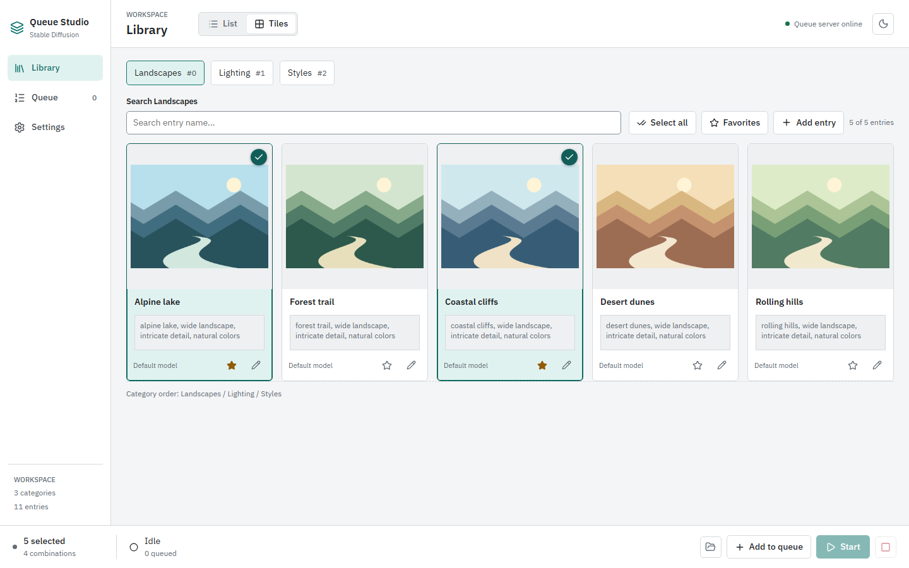

<!-- markdownlint-disable MD033 MD041 -->

<p align="center">

</p>

<h1 align="center">Queue Studio</h1>

<p align="center">
<a href="https://github.com/Nicofire/Stable-Diffusion-Queue-Manager-V2/actions/workflows/ci.yml"></a>
<a href="https://nodejs.org/"></a>
<a href="https://react.dev/"></a>
<a href="https://www.typescriptlang.org/"></a>
<a href="https://vite.dev/"></a>
</p>

<p align="center">
<strong>Your prompt library, generation queue, and AUTOMATIC1111 workspace.</strong><br />
Compose prompts, organize entries, and manage Stable Diffusion generations locally.
</p>

<p align="center">
<a href="#quick-start">Quick Start</a> &middot;
<a href="docs/wiki/README.md">User Wiki</a> &middot;
<a href="#features">Features</a> &middot;
<a href="#data-and-persistence">Your Data</a> &middot;
<a href="#development">Development</a>
</p>

<!-- markdownlint-enable MD033 MD041 -->

---

> **Local-first.** Queue Studio manages your library, jobs, previews, and output. Image generation runs in your separate AUTOMATIC1111 WebUI instance.



Actual application UI with neutral demo data and original illustrative thumbnails. Generation in the documentation screenshots is simulated; these are not examples of model output.

Explore the **[User Wiki](docs/wiki/README.md)** for illustrated guides to npm every page, entry previews, image import, queue controls, and settings.

## Features

| Workspace              | What you can do                                                                                               |
| ---------------------- | ------------------------------------------------------------------------------------------------------------- |
| **Library**            | Browse list and tile views, search, filter favorites, select entries, and create categories.                  |
| **Entry editor**       | Create, edit, and delete entries with positive and negative prompts, LoRAs, models, and preview images.       |
| **Image import**       | Import supported generation metadata from dropped images into the entry editor.                               |
| **Preview generation** | Generate a 2x2 or 3x3 batch and choose the image to save with an entry.                                       |
| **Queue**              | Build jobs from selected category entries, add or clear jobs, start or resume, pause between jobs, and abort. |
| **Progress**           | Track generation status, image count, image timings, and estimated remaining duration across all pages.       |
| **Settings**           | Configure the AUTOMATIC1111 connection, model, seed, steps, dimensions, and global prompt presets.            |
| **Appearance**         | Switch between light and dark themes, with Lucide icons and a matching Layers favicon.                        |

## Requirements

- Node.js 20.19+ in the 20.x line, or Node.js 22.12+; a current LTS release is recommended.
- npm and a modern browser.
- For image generation: a running AUTOMATIC1111 WebUI instance with its API enabled using `--api`.

## Quick Start

Run these commands from the repository root:

```bash
npm install
npm run dev
```

Open the local URL printed by Vite, normally `http://localhost:5173`. The development server also provides the local API used for project data and generation.

On Windows, double-click [webui-user.bat](webui-user.bat) to start Queue Studio and open the browser after dependencies are installed. Despite its name, this script starts Queue Studio, not AUTOMATIC1111.

### Connect AUTOMATIC1111

1. Start your separate AUTOMATIC1111 WebUI with `--api` enabled.
2. Open **Settings** in Queue Studio.
3. Set the API URL, normally `http://127.0.0.1:7860`, and select a model.
4. Configure seed, steps, image dimensions, and prompt presets as needed.

The local API forwards generation requests to AUTOMATIC1111. Library browsing and editing do not require a running image-generation backend; generating previews and queue images does.

### Generate Images

1. In **Library**, select entries from the categories you want to combine.
2. Add the selection to the queue. Global prompt presets are included in the composed prompts.
3. Open **Queue** to inspect jobs and start generation.
4. Use the generation controls to pause, resume, abort, or open the output folder.

Queue-generated images are saved under `output/YYYY-MM-DD/`. Entry-editor previews are not written to that output folder; saving an entry stores its chosen preview with the library assets.

## Data and Persistence

| Location                                                 | Contents                                        |
| -------------------------------------------------------- | ----------------------------------------------- |
| [data/categorys/](data/categorys/)                       | Category definitions and entries as JSON files. |
| [data/settings.json](data/settings.json)                 | Connection, generation, and theme settings.     |
| [data/positive-presets.json](data/positive-presets.json) | Global positive prompt presets.                 |
| [data/negative-presets.json](data/negative-presets.json) | Global negative prompt presets.                 |
| [public/static/images/](public/static/images/)           | Library image assets.                           |
| `output/YYYY-MM-DD/`                                     | Generated queue images, grouped by local date.  |

The `categorys` spelling matches the current file structure.

Missing settings and preset files in `data/` are initialized from the corresponding defaults in `public/`. Settings and presets also use browser local storage.

> **Back up your work.** Preserve `data/`, library images in `public/static/images/`, and `output/`. The active queue and its statistics are held in server memory and are lost when the development server restarts.

## Development

The project uses React 19, TypeScript, Vite, Lucide React, IBM Plex Sans, ESLint, and Playwright.

### Build and Lint

```bash
npm run build
npm run lint
```

The build runs TypeScript project checks and creates the frontend bundle in `dist/`.

### Tests

Install Playwright's Chromium browser once, then run the test suite:

```bash
npx playwright install chromium
npm run test:ui
```

The suite covers browser workflows and layouts, generation statistics, and a generation API integration test using temporary project data and a fake image-generation server. It does not require AUTOMATIC1111.

Playwright uses `http://127.0.0.1:5181` and starts a Vite server automatically, or reuses an existing server on that address outside CI. Keep that port free of unrelated servers.

### Refresh Documentation Screenshots

After installing Playwright's Chromium browser as described above, run the focused capture scenario:

```bash
npm run test:ui -- tests/ui.spec.ts --grep "documentation screenshots"
```

It renders the real UI with isolated API mocks and original PNG illustrations; it does not use your library, change project settings, or call AUTOMATIC1111. Captures use a 1440x900 desktop viewport, with a taller 1440x1100 viewport for the complete presets section.

Review the eight PNGs in `test-results/ui-documentation-screenshots/`, then copy the approved images to [docs/screenshots/](docs/screenshots/) using the same filenames. Keep the demo-data captions accurate when updating the [wiki](docs/wiki/README.md). Only curated images belong in the repository; do not commit `test-results/` or `playwright-report/`.

### Continuous Integration

The [GitHub Actions workflow](.github/workflows/ci.yml) runs on every push and pull request. It can also be started manually from **Actions > CI > Run workflow** once the workflow is on the default branch.

Both jobs run on **Ubuntu 24.04** (`ubuntu-24.04`) and **Windows Server 2025** (`windows-2025`), producing four independent job executions with Node.js 22 and cached npm downloads. Runner versions are pinned to avoid automatic operating-system migrations. Matrix fail-fast is disabled, so a failure on one platform does not cancel the other platform's checks. Artifact uploads use `actions/upload-artifact@v7`, which runs on Node.js 24 independently of the application's Node.js version.

| Job                       | Checks and artifacts                                                                                                                                                                                                                             |
| ------------------------- | ------------------------------------------------------------------------------------------------------------------------------------------------------------------------------------------------------------------------------------------------ |
| **Lint and build**        | On each OS: installs locked dependencies with `npm ci`, runs ESLint and the TypeScript/Vite build, and uploads `frontend-dist-<runner>` for 7 days.                                                                                              |
| **Browser and API tests** | On each OS: installs Chromium (including Linux system dependencies on Ubuntu), runs the full Playwright suite, and uploads `playwright-results-<runner>` for 14 days, including HTML/JUnit reports and available failure screenshots and traces. |

Open a workflow run in GitHub Actions to inspect job logs and download its artifacts. Tests use mocked or local fake APIs, so no GPU, AUTOMATIC1111 instance, or repository secrets are required. A newer run cancels an older in-progress run for the same branch or pull request.

Artifact names include the runner label to prevent collisions, for example `frontend-dist-windows-2025` and `playwright-results-ubuntu-24.04`. Each `frontend-dist-<runner>` artifact contains only the built frontend. This workflow does not deploy the application; the local API still requires the development server described below.

### Production Preview and Limitations

```bash
npm run build
npm run preview
```

> **Frontend preview only.** The project API is **not available in preview mode or on static hosting**. Use `npm run dev` for the complete local application.

`npm run preview` serves only the built frontend. The project API is registered through Vite's development-server middleware; a standalone production backend is not included.

The local API can modify project files and initiate generation. Keep the server local; it is not an authenticated, multi-user service intended for public exposure.

## Project Structure

```text
.
|-- .github/workflows/ci.yml # GitHub Actions checks and test reports
|-- data/                    # Persistent categories, settings, and presets
|-- dev-server/              # Local APIs and AUTOMATIC1111 integration
|-- docs/
|   |-- screenshots/         # Curated application screenshots with demo data
|   `-- wiki/                # Illustrated user guides
|-- output/                  # Generated queue images by date
|-- public/                  # Favicon, default JSON files, and library assets
|-- src/
|   |-- components/          # Shared UI and entry dialogs
|   |-- features/
|   |   |-- categories/      # Category data, selection, and entry actions
|   |   |-- generation/      # Queue client, prompt composition, and statistics
|   |   `-- settings/        # Shared project settings state
|   |-- pages/               # Library, queue, and settings views
|   |-- App.tsx              # Application shell and shared state
|   |-- App.css
|   `-- main.tsx
|-- tests/                   # Playwright UI and generation tests
|-- index.html
|-- package.json
|-- playwright.config.ts
|-- vite.config.ts
`-- webui-user.bat           # Windows launcher for Queue Studio
```
