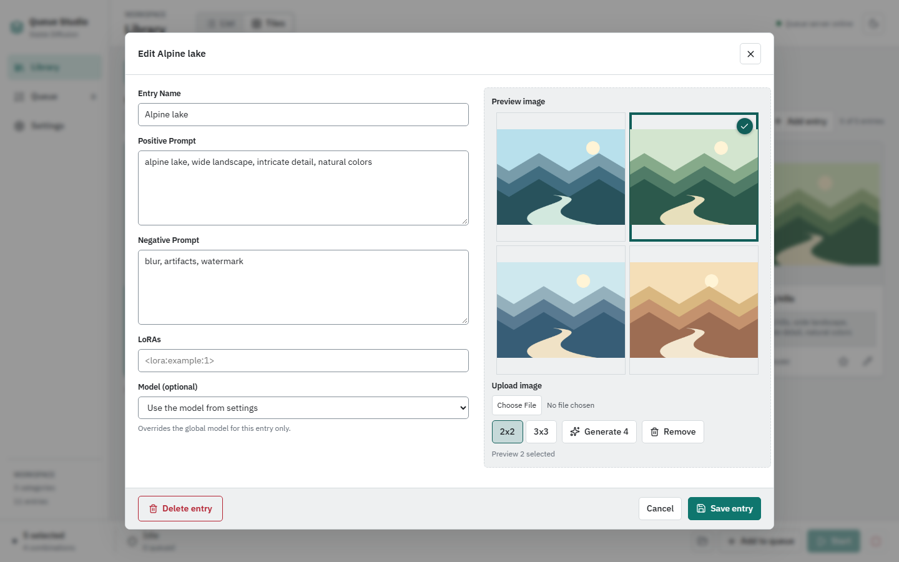

# Entry Editor

[Wiki Home](README.md) | [Previous: Library](Library.md) | [Next: Queue](Queue.md)

Create an entry with a category's plus button or **Add entry**. Use an existing entry's pencil to edit it. The same editor is available from List and Tiles.

The example shows original illustrative thumbnails returned by the documentation fixture, not images generated by a model.

## Entry Fields

| Field                | Purpose                                                                                               |
| -------------------- | ----------------------------------------------------------------------------------------------------- |
| **Entry Name**       | The name shown in Library and queue job labels; required to save.                                     |
| **Positive Prompt**  | What the entry contributes to the image prompt.                                                       |
| **Negative Prompt**  | What the entry contributes to the negative prompt.                                                    |
| **LoRAs**            | LoRA prompt syntax, for example `<lora:landscape-style:0.8>`, using a LoRA installed in your backend. |
| **Model (optional)** | A checkpoint override. Leave it empty to use the model from Settings.                                 |

The editor loads available model names from AUTOMATIC1111. If that list is unavailable, you can enter a checkpoint name manually. A name here does not download or install a model.

Choose **Save entry** to persist your changes. **Cancel**, the close button, or Escape closes the editor; if there are unsaved changes, choose whether to discard them or keep editing.

When several selected entries specify different models for one queue job, the last distinct model in category order is used. Avoid conflicting overrides unless you intend this behavior; see [Queue](Queue.md#how-prompts-are-composed).

## Upload or Drop an Image

Use **Upload image** or drop an image into the preview area. The file picker accepts PNG, JPEG, WebP, and BMP. Saving the entry stores its chosen preview in the library image assets.

PNG files can also supply prompt metadata. The current importer reads AUTOMATIC1111's `parameters` value from PNG `tEXt` or uncompressed `iTXt` chunks. It imports the first positive-prompt line and the line beginning `Negative prompt:` followed by a space.

Imported prompt text is appended to existing text with a comma, unless that incoming text is already contained in the field. Review the result before saving.

Metadata import is deliberately limited: it does not restore model, seed, steps, dimensions, or a full workflow. JPEG, WebP, and BMP can be used as preview images, but do not import prompts through this PNG-specific reader. PNGs with missing, stripped, or compressed text metadata may also provide only an image.

## Generate a Preview Batch

1. Configure and save a working AUTOMATIC1111 connection in [Settings](Settings.md).
2. Add a positive prompt or LoRA in the editor.
3. Select **2x2** for four previews or **3x3** for nine.
4. Choose **Generate 4** or **Generate 9** and wait for the batch.
5. Click the preview you want to keep. Only one preview can be selected; the first is selected initially.
6. Choose **Save entry** to store that image with the entry.

Global prompt presets also apply to preview generation. Changing the batch-size toggle affects the next generation request, not the existing grid. Generating another batch replaces the grid; unsaved alternatives are not a permanent gallery.

Previews are not written to the queue's `output/` folder. Until you save the entry, the preview selection is not stored as a library asset. Preview generation is unavailable while the queue is running or paused.

## Remove an Image or Delete an Entry

**Remove** clears the current preview selection. Save the entry to persist removal of an existing preview, or upload/generate a replacement before saving.

In edit mode, **Delete entry** opens an inline confirmation. **Confirm delete** permanently removes the entry and its associated preview asset. Cancel the confirmation to keep it. There is no undo or recycle bin, so back up your library first.

[Wiki Home](README.md) | [Previous: Library](Library.md) | [Next: Queue](Queue.md)
