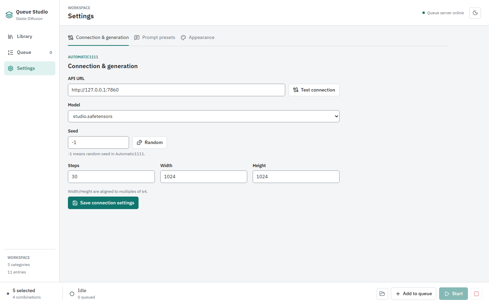

# Getting Started

[Wiki Home](README.md) | [Next: Library](Library.md)

## Install and Launch

You need npm, a modern browser, and Node.js 20.19+ in the 20.x line or Node.js 22.12+. A current LTS release is recommended.

From the repository root:

```bash
npm install
npm run dev
```

Open the URL Vite prints, normally `http://localhost:5173`. On Windows, the repository's [webui-user.bat](../../webui-user.bat) can launch Queue Studio and open a browser after dependencies have been installed. It does not start AUTOMATIC1111.

Keep the development server running while using the app. It supplies both the frontend and the API that reads and writes your local project data.

## Connect AUTOMATIC1111

1. Start your separate AUTOMATIC1111 WebUI with `--api` enabled.
2. Open **Settings > Connection & generation** in Queue Studio.
3. Enter the backend's base **API URL**, normally `http://127.0.0.1:7860`.
4. Choose **Test connection**, then select an available **Model**.
5. Set **Seed**, **Steps**, **Width**, and **Height**. A seed of `-1` requests a random seed; dimensions are aligned to multiples of 64.
6. Choose **Save connection settings** and check the success message.



This example uses a simulated model list. Your dropdown shows checkpoints installed in your own AUTOMATIC1111 instance. Library browsing and editing work without that backend; image generation does not.

## Create Your First Entries

1. Open **Library** in **List** view and choose **Add category**.
2. Give the category a descriptive name, such as `Landscapes`.
3. Use the category's plus button to add an entry.
4. Enter a name and a positive prompt, such as `alpine lake, wide landscape, natural light`.
5. Optionally add a negative prompt, LoRAs, a model override, or an image, then choose **Save entry**.

See the [Entry Editor](Entry-Editor.md) guide for image metadata and preview batches.

## Generate a Queue Image

1. Select the entry in Library. Select entries in other categories if you want to combine their prompts.
2. Check the combination count in the bottom bar, then choose **Add to queue**.
3. Open **Queue** and inspect the waiting job labels.
4. Choose **Start** in the bottom bar.
5. Follow the progress and use **Open output** to open today's output folder.

Queue images are saved under `output/YYYY-MM-DD/`, using the local date. An entry-editor preview is different: only the chosen preview is stored with the entry when you save it.

Set reusable positive and negative defaults under [Settings > Prompt presets](Settings.md#prompt-presets) before adding jobs. Those presets are included in composed queue prompts.

[Wiki Home](README.md) | [Next: Library](Library.md)
