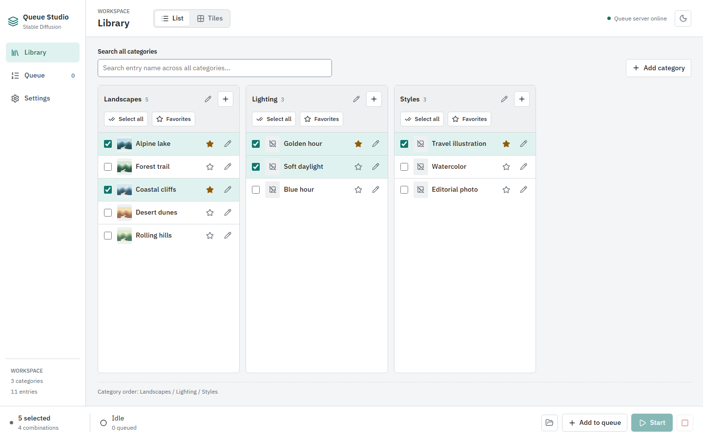
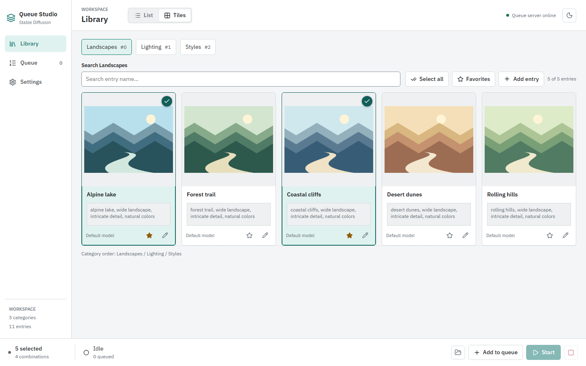

# Library

[Wiki Home](README.md) | [Previous: Getting Started](Getting-Started.md) | [Next: Entry Editor](Entry-Editor.md)

Library holds reusable entries grouped into categories. An entry can contain prompts, LoRAs, an optional model override, a favorite flag, and a preview image.

## List View

Choose **List** at the top of Library to compare categories side by side.

- Use **Search all categories** to filter by entry name across the library.
- Tick an entry's checkbox to include it in your selection.
- Use a category's **Select all** button to toggle its currently visible entries. A search or favorite filter limits which entries this button affects.
- Toggle **Favorites** to show only starred entries in that category. Use the star beside an entry to change its favorite state.
- Use the pencil beside an entry to open its editor; the plus button in a category header creates an entry.

## Tile View

Choose **Tiles** to inspect larger previews and positive prompts. Use the category tabs to switch the active category.

Search applies to entry names in the active category. The toolbar also offers **Select all**, **Favorites**, and **Add entry**, with a visible-entry count.

Click a tile to select or deselect it. Selected tiles have an accent outline and checkmark. The tile's star and pencil change its favorite state or open its editor without changing its selection. A tile without a custom model displays **Default model**.

List and tile views share the same selection. Searches and filters remain in place when switching views or visiting another page during the current session.

## Manage Categories

In List view, choose **Add category** to create a category. Use a category header's pencil to rename it. Drag category headers to rearrange their order.

Category order also determines the order of entry prompt parts in composed jobs. Keep commonly combined categories in a predictable order, such as subject, lighting, and style.

Category changes and saved entries are written to `data/categorys/`. The folder name uses the project's existing `categorys` spelling.

## Build a Selection

You can select multiple entries in each category. Every choice in one category combines with each selected choice in the others.

For example, two landscapes, two lighting entries, and one style produce **four jobs**, not five. A category without a selection contributes no entry text and does not multiply the job count.

The bottom bar shows both the selected-entry count and combination count. Filters do not automatically clear hidden selections, so review that count before choosing **Add to queue**. At least one entry must be selected to add jobs.

Adding jobs does not start generation. Open [Queue](Queue.md) to review the waiting labels and choose **Start** when ready.

[Wiki Home](README.md) | [Previous: Getting Started](Getting-Started.md) | [Next: Entry Editor](Entry-Editor.md)
