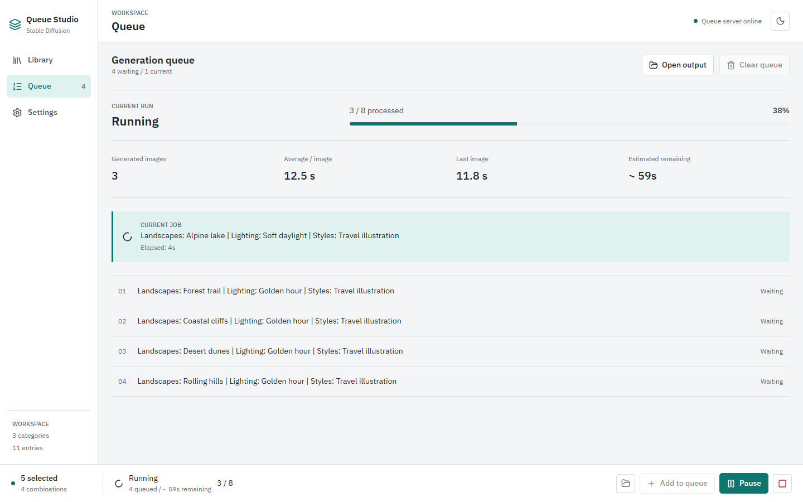

# Queue and Generation

[Wiki Home](README.md) | [Previous: Entry Editor](Entry-Editor.md) | [Next: Settings](Settings.md)

Queue turns your Library selection into generation jobs. The Queue page shows the current job, waiting job labels, run progress, and timing statistics. Generation controls remain in the bottom bar on every page.

The running state and timings above are simulated demo values, not a measured model benchmark.

## Add Jobs from Library

1. Select entries in [Library](Library.md).
2. Check the combination count in the bottom bar.
3. Choose **Add to queue** to append those combinations.
4. Open Queue to review the waiting job labels, then choose **Start**.

Selections are combined across categories: two landscapes and three lighting choices produce six jobs. Unselected categories contribute no entry text. Repeating **Add to queue** adds the selection again; it is not a deduplication command.

You cannot add or clear jobs while a run is running or paused. Queue labels summarize the selected entry names rather than showing a complete prompt editor.

## How Prompts Are Composed

Each job takes one selected entry from each participating category, following category order.

| Prompt   | Assembly order                                                                        |
| -------- | ------------------------------------------------------------------------------------- |
| Positive | Selected global positive preset, entry positive prompts, then entry LoRAs.            |
| Negative | Selected global negative preset, then entry negative prompts.                         |
| Model    | The last distinct nonempty entry model in category order, otherwise the global model. |

Empty prompt parts are omitted. Global presets and entry text become part of the queued job when you add it; editing an entry or preset later does not rewrite existing jobs. Clear and re-add jobs if you need to change their prompt content.

The **Effective prompt** section in [Settings](Settings.md#prompt-presets) shows the composition pattern with placeholders, not the exact text of every waiting job.

## Generation Controls

| Control                       | Behavior                                                                                           |
| ----------------------------- | -------------------------------------------------------------------------------------------------- |
| **Start**                     | Starts processing waiting jobs. Requires a nonempty queue.                                         |
| **Pause**                     | Pauses between jobs. An already-running image request can finish and save before the worker waits. |
| **Resume**                    | Continues a paused run without creating a new selection.                                           |
| **Abort generation**          | Cancels the app's active request and discards waiting jobs. Already-saved output is kept.          |
| **Clear queue**               | Removes waiting jobs and resets the queue while generation is inactive.                            |
| **Open output** / folder icon | Opens today's `output/YYYY-MM-DD/` directory on the computer running the local server.             |

Abort cancels Queue Studio's request; it is not a guarantee that AUTOMATIC1111 immediately stops GPU work. After aborting, add the combinations again to generate them in a new run.

The **Queue server online** indicator means Queue Studio can reach its own local API. It does not prove that AUTOMATIC1111 is available; use **Test connection** in Settings for that check.

## Progress and Statistics

The progress bar counts processed jobs. A failed request can still advance that count, so it is not the same as the number of images successfully saved. Review any error message as well as the image count.

- **Generated images** counts successfully saved queue images.
- **Average / image** uses successful generation timing samples from the current run.
- **Last image** shows the latest successful timing sample.
- **Estimated remaining** estimates remaining work after the first successful sample and accounts for time already spent on the current job. Before that, the UI shows that it is still estimating.

During a pause, the remaining value describes outstanding work rather than a continuously counting-down deadline. These values are estimates, not guaranteed finish times. Entry-editor previews do not contribute to queue statistics.

## Output and Persistence

Queue images are saved under `output/YYYY-MM-DD/`, grouped by the server's local date. Existing output is not removed by clearing or aborting the queue.

The active queue and statistics are held in server memory, not a durable job history. Changing pages or reloading the browser can reconnect to that running server; restarting the development server loses the queue. Browser Library selections are separate from queued jobs.

[Wiki Home](README.md) | [Previous: Entry Editor](Entry-Editor.md) | [Next: Settings](Settings.md)
