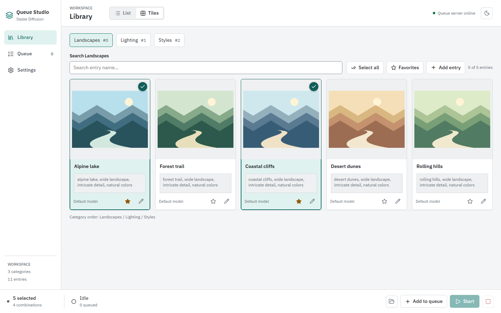

# Queue Studio User Wiki

[Project README](../../README.md) | [Getting Started](Getting-Started.md)

Queue Studio is a local workspace for organizing reusable prompts and generating combinations through a separate AUTOMATIC1111 WebUI. This wiki covers the Library, Queue, Settings, and entry editor.

All screenshots show the actual application with neutral demo data and original illustrative thumbnails. Preview batches, running jobs, and timing values are simulated for documentation; they do not demonstrate a connected model or real generation speed.

## Guides

| Guide                                 | What it covers                                                       |
| ------------------------------------- | -------------------------------------------------------------------- |
| [Getting Started](Getting-Started.md) | Installation, backend connection, and your first generation.         |
| [Library](Library.md)                 | List and tile views, categories, search, favorites, and selections.  |
| [Entry Editor](Entry-Editor.md)       | Prompts, LoRAs, models, image import, preview batches, and deletion. |
| [Queue and Generation](Queue.md)      | Combinations, generation controls, progress, statistics, and output. |
| [Settings](Settings.md)               | Connection, generation parameters, global presets, and appearance.   |
| [Troubleshooting](Troubleshooting.md) | Connection failures, missing metadata, output, and persistence.      |

## Workspace Navigation

- **Library** stores your reusable entries. Switch between **List** and **Tiles** without rebuilding your selection.
- **Queue** shows the current job, waiting jobs, and generation statistics.
- **Settings** contains **Connection & generation**, **Prompt presets**, and **Appearance**.
- The bottom generation bar remains available on all pages. It shows selected entries, combination count, queue state, and generation controls. Click its status area to open Queue.
- The sun or moon button in the header switches the theme.

## Where Your Work Lives

Category JSON files live in `data/categorys/`, library previews in `public/static/images/`, and queue images in `output/YYYY-MM-DD/`. Settings and global presets live in `data/`; browser local storage also retains settings and presets.

Back up those folders before moving or reinstalling the application. The active queue and its statistics live only in server memory and disappear when the development server restarts. Browser selections are not a saved queue or a durable history.

Use `npm run dev` for the complete application. Static hosting and `npm run preview` do not provide the local project API. Keep the server local: it is not an authenticated public service.

[Start the walkthrough](Getting-Started.md) | [Troubleshooting](Troubleshooting.md)
