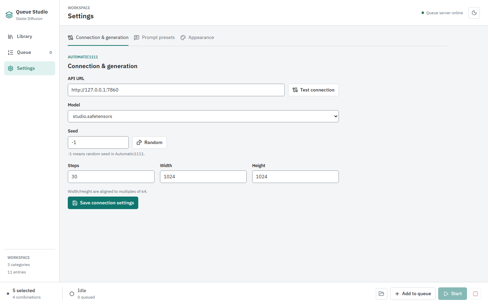
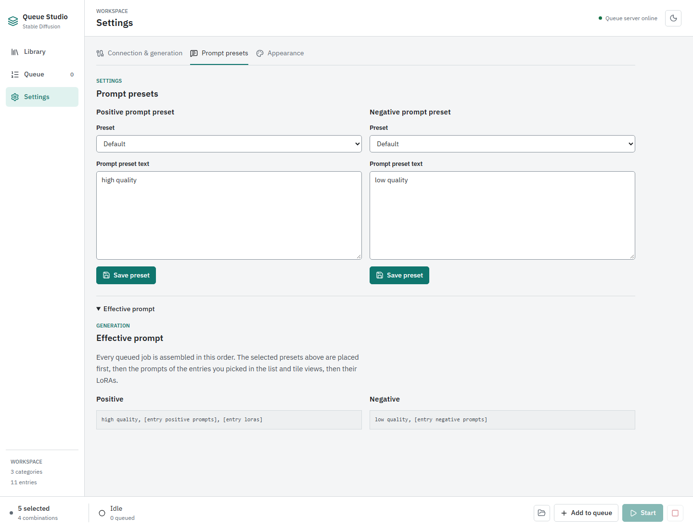
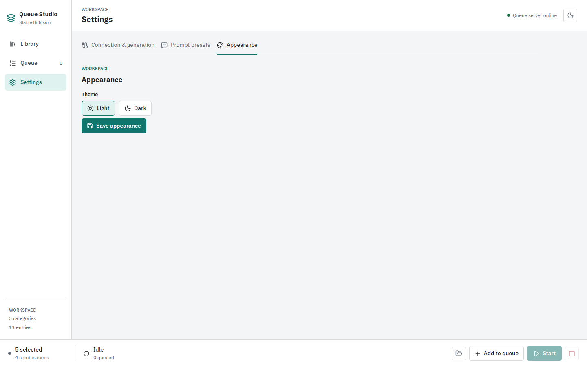
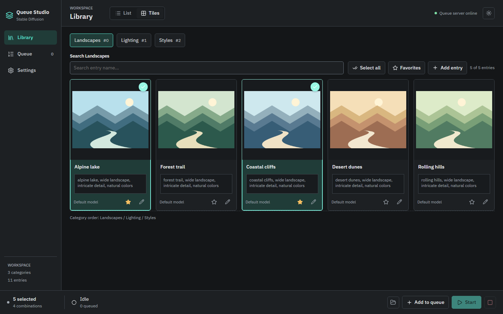

# Settings

[Wiki Home](README.md) | [Previous: Queue](Queue.md) | [Next: Troubleshooting](Troubleshooting.md)

Settings has three sections: **Connection & generation**, **Prompt presets**, and **Appearance**. Each section has its own save controls. Make changes before starting a queue and check the save result before reloading or generating images.

## Connection and Generation

The screenshot uses a local demo URL and simulated model list. Configure these values for your own backend:

| Field or action              | Meaning                                                                                                                                |
| ---------------------------- | -------------------------------------------------------------------------------------------------------------------------------------- |
| **API URL**                  | Base URL of your separate AUTOMATIC1111 instance, normally `http://127.0.0.1:7860`. Use the backend URL, not Queue Studio's Vite URL.  |
| **Test connection**          | Requests the backend's model list through the local proxy and reports whether it is reachable. AUTOMATIC1111 needs `--api`.            |
| **Model**                    | Default checkpoint for generation. Available models load from the configured backend. Entry-specific overrides can replace it.         |
| **Seed**                     | Numeric generation seed. `-1` means random; **Random** resets the field to `-1`.                                                       |
| **Steps**                    | Number of sampling steps, rounded to a whole number with a minimum of 1.                                                               |
| **Width / Height**           | Output dimensions, with a minimum of 64 and alignment to multiples of 64. Use values supported by your model and available GPU memory. |
| **Save connection settings** | Writes connection and generation values to the project settings file.                                                                  |

A fixed seed is useful for comparisons, but seed alone does not guarantee identical results across different models, prompts, dimensions, or backend configurations.

## Prompt Presets

Choose a positive and negative preset independently using their **Preset** dropdowns. Edit the corresponding **Prompt preset text**, then choose that editor's **Save preset**. The positive and negative groups are saved separately.

Presets provide global text reused across entries. For example, a positive preset might contain `high quality`, while a negative preset contains `low quality, watermark`. These example preferences are not mandatory generation settings.

Expand **Effective prompt** to see how text is assembled: the selected global preset comes first, followed by entry prompts, and then LoRAs on the positive side. The `[entry ...]` placeholders describe the pattern; they are not a live preview of an individual waiting job.

Set your presets before adding jobs to the queue. Changing a preset does not rewrite jobs already added. The same preset composition is also used for entry-editor previews.

Preset groups are stored in `data/positive-presets.json` and `data/negative-presets.json`. The UI selects and edits existing presets; it does not provide a separate create/delete preset manager.

## Appearance

Choose **Light** or **Dark** and use **Save appearance** to persist the choice to the project. The sun/moon button in the application header also lets you switch themes while working.

Both themes use the same controls and library data. Switching appearance does not alter your prompts or create a separate queue.

## Saving and Defaults

Connection and appearance settings live in `data/settings.json`. Missing settings and preset files are initialized from the corresponding defaults in `public/`; browser local storage also retains settings and presets.

If a save fails, the UI reports an error and may offer a JSON download as a fallback. A downloaded file is not proof that the project file was updated. Check that the local development API is running, resolve the error, and save again.

Use `npm run dev` for persistence through the local API. `npm run preview` and a static file host provide only the frontend, not the full application.

[Wiki Home](README.md) | [Previous: Queue](Queue.md) | [Next: Troubleshooting](Troubleshooting.md)
