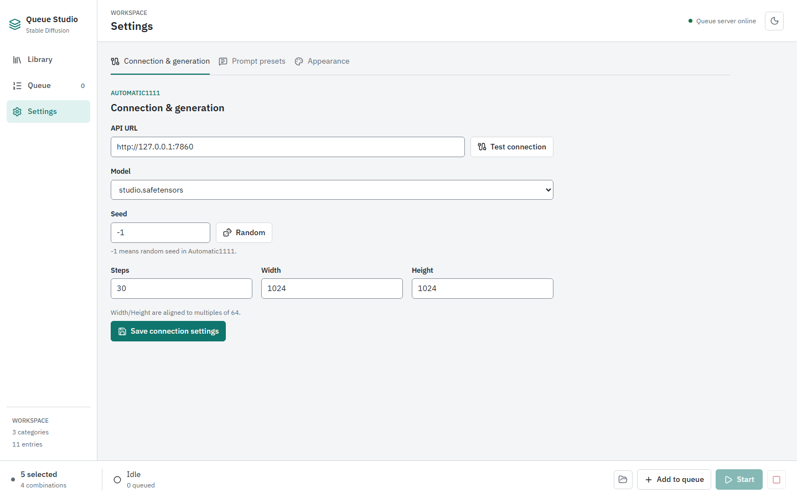

# Troubleshooting

[Wiki Home](README.md) | [Previous: Settings](Settings.md)

## Queue Server Offline

Start Queue Studio with `npm run dev` from the repository root and keep that process running. Open the URL Vite prints. The built frontend served by `npm run preview` or static hosting does not include the local API.

**Queue server online** only confirms that Queue Studio's API is reachable. It does not test the image-generation backend.

## AUTOMATIC1111 Connection or Model List Fails

1. Confirm that your separate AUTOMATIC1111 instance is running with `--api` enabled.
2. Open **Settings > Connection & generation** and verify its base **API URL**, usually `http://127.0.0.1:7860`.
3. Choose **Test connection** and read the reported result.
4. Check that AUTOMATIC1111 has an installed checkpoint, then select the model and save the connection settings.

Do not use Queue Studio's `5173` development URL as the backend URL. A server running on another computer needs a reachable address and appropriate network configuration; keep Queue Studio's own file-modifying API local.

If the entry editor cannot load model choices, it permits a manual checkpoint name. That fallback does not fix a disconnected backend or install a missing model.

## Image Imports Without Prompts

The image can still be used as a preview. Automatic prompt import requires a PNG with a supported AUTOMATIC1111 `parameters` text chunk. Re-exporting, editing, or messaging an image may strip that metadata.

The importer reads the first positive-prompt line and a line starting with `Negative prompt:` followed by a space from supported uncompressed PNG text metadata. It does not reconstruct multiline prompts, seed, steps, model settings, or arbitrary workflows. JPEG, WebP, and BMP preview uploads do not import this PNG metadata.

Enter or correct prompts manually before saving. See [Entry Editor](Entry-Editor.md#upload-or-drop-an-image) for supported formats and merge behavior.

## Preview Generation Fails or Is Busy

Add a positive prompt or LoRA before choosing **Generate 4** or **Generate 9**. Confirm that the saved backend settings and selected model are valid. Finish or abort an active or paused queue before requesting editor previews.

Check error messages and the AUTOMATIC1111 terminal. Large dimensions or a nine-image batch may exceed available GPU memory; try a smaller supported resolution or the four-image batch.

## Pause Does Not Stop the Current Image

Pause takes effect between jobs. A request already in progress may finish and save before the next job is held. Use **Resume** to continue.

**Abort generation** discards waiting jobs and cancels Queue Studio's current request. The backend may continue GPU work independently; abort is not a guaranteed backend interrupt. Existing output files are kept.

## Missing Images or Output Folder

Queue output is written to `output/YYYY-MM-DD/` on the computer running the development server, using its local date. Use **Open output** on Queue or the folder icon in the bottom bar.

An entry-editor preview does not go into that folder. Select a preview and choose **Save entry** to store it with the library assets. Unselected alternatives are not saved as a persistent batch gallery.

If a folder cannot be opened automatically, inspect the repository's `output/` directory using your file manager. A processed job count is not a successful image count; review Queue's error message and **Generated images** as well.

## Queue or Selections Disappeared

The queue and its statistics are stored in development-server memory. Restarting that server loses them; the app does not restore a saved job history. Browser selections are separate UI state and are not a durable backup.

Saved category entries, preview assets, settings, and output files live on disk. Preserve `data/`, `public/static/images/`, and `output/` when moving the project.

## Settings Do Not Persist

Use the save control belonging to the changed section: **Save connection settings**, each group's **Save preset**, or **Save appearance**. Check for a success message. A fallback JSON download after a save error does not update the project's data by itself.

Make sure you are running the development server, not frontend-only preview mode, and that project files are writable. See [Settings](Settings.md#saving-and-defaults) and the [README persistence guide](../../README.md#data-and-persistence).

[Wiki Home](README.md) | [Previous: Settings](Settings.md)
