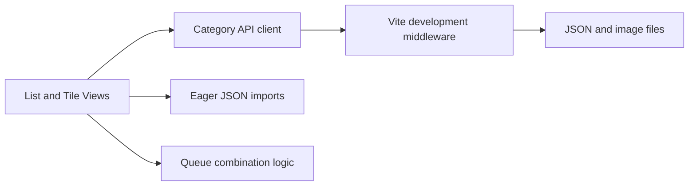

Compacted conversation

Updated todo list

I’ll review the current frontend data flow, server persistence boundary, and the recently changed files, then give you a prioritized architecture assessment without modifying the project.

I’m going to trace the architecture from category loading through React state and HTTP mutations to file persistence, with special attention to production behavior and consistency after runtime writes.

Review queue manager architecture

The current structure confirms a clean separation at the module level, but the more important boundary is still blurred: category reads are bundled into the frontend while writes go through a development-only server. I’m checking the exact evidence and secondary risks now so the recommendations are ranked by impact rather than file size.

The highest-impact issue is confirmed: each view owns a separate snapshot built from an eager Vite glob, while mutations update only the mounted List View state. The server-side concerns are real but more specific than “JSON is unsafe”: overlapping read-modify-write operations and multi-file reorder are the corruption risks; generated image paths themselves are constrained.

The project is currently a capable local development prototype, not yet a deployable application: `vite build` emits a static frontend, while every write endpoint exists only inside `configureServer`. I’m checking validation, API contracts, and interaction accessibility next to separate immediate correctness work from longer-term production architecture.

Validation reveals one concrete server security boundary issue, but it is the category ID, not the uploaded image name: several endpoints interpolate client-supplied `categoryId`/`oldId` into `path.resolve` without first requiring a slug. The request reader is also unbounded, so base64 uploads can consume arbitrary memory before endpoint validation runs.

Searched for files matching `**/queue-manager/**/*.{test,spec}.{ts,tsx,js,jsx}`, no matches

No matches found. Your search pattern might be excluded completely by either the search.exclude settings or .*ignore files.
If you believe that it should have results, you can check into the .*ignore files and the exclude setting (here are some excluded patterns for reference:[**/node_modules,**/bower_components,**/*.code-search]).
Then if you want to include those files you can call the tool again by setting "includeIgnoredFiles" to true.

The queue algorithm itself is appropriately small and pure, which is a good foundation for tests. Its main scalability limit is materializing the full Cartesian product when actual queue execution is added; the current summary wisely computes only the product count, but downstream generation should remain lazy or batched.

**Architecture Summary**

The project has evolved into a well-structured local prototype:

The component and module boundaries are improving, but the application currently has two competing data paths: static category imports for reads and development middleware for writes. Resolving that split should be the next architectural milestone.

**What Is Working Well**

- Category behavior is grouped under src/features/categories, rather than embedded entirely in pages.
- vite.config.ts is now a thin composition layer.
- Server responsibilities are separated into category, config, Automatic1111, and HTTP utility modules under dev-server.
- Queue generation in queueBuilder.ts is generic, ordered by `placeId`, pure, and easy to test.
- List and Tile views reuse selection and queue-summary logic.
- Category types are explicit in categoryTypes.ts.
- Category mutations use meaningful HTTP statuses and client-visible error messages.
- Optimistic reorder and favorite mutations do have rollback behavior in ListViewPage.tsx and ListViewPage.tsx.
- TypeScript and ESLint are configured strictly, and the latest recorded lint run passed.

**Highest-Priority Issues**

1. **Production builds have no persistence backend**

   The APIs are registered only through Vite’s `configureServer` hook in project-api-plugin.ts. They do not exist after `vite build`, and `vite preview` cannot provide category writes.

   Decide the intended deployment model:
   - For a normal web application, create a small Node backend using Fastify or Express and serve or proxy the Vite frontend.
   - For a local desktop application, consider Tauri or Electron with a controlled filesystem API.
   - Keep Vite responsible only for frontend development and building.

2. **Reads and writes use different sources of truth**

   categoryData.ts loads JSON through an eager `import.meta.glob`. Those files become frontend modules. Meanwhile, mutations write directly to disk through HTTP.

   TileViewPage.tsx stores an especially static module-level category snapshot. List View updates only its own local state.

   HMR may sometimes hide this problem during development, but it is not a reliable synchronization mechanism. Add `GET /api/categories` and make the backend the canonical read and write source. Both views should consume one shared category store or query cache.

3. **Filesystem paths accept untrusted category IDs**

   Entry creation, favorite updates, and rename operations resolve client-provided identifiers into filesystem paths. For example, categorys-api.ts interpolates `categoryId` directly.

   Validate that IDs match the canonical slug format before resolving paths, and assert that every resolved path remains inside `data/categorys`. The rename endpoint must apply the same validation to `oldId`.

4. **Request bodies are unbounded**

   http-utils.ts accumulates the entire body in a string without a size limit. Base64 images make this particularly risky.

   Add a request-size limit, validate decoded image size and file signatures, and eventually switch image uploads to `multipart/form-data`. This also avoids base64’s roughly 33% size overhead.

5. **JSON mutations are vulnerable to lost updates**

   Entry creation and favorite toggling both perform independent read-modify-write cycles. Two overlapping operations on the same category can overwrite one another. Reordering is worse because it rewrites multiple category files sequentially in categorys-api.ts.

   Short-term protection:
   - Serialize mutations per category.
   - Write to a temporary file and atomically rename it.
   - Store category order in one manifest instead of rewriting every category.

   Long-term, SQLite is a strong fit. Categories, entries, order, and favorites naturally map to tables, and transactions solve the multi-file consistency problem.

**Frontend Improvements**

- Lift category data and selections above individual pages. App.tsx currently mounts only the active page, so each view owns independent state.
- Introduce focused domain hooks such as `useCategories`, `useCreateCategory`, `useReorderCategories`, and `useFavoriteMutation`. Keep page components responsible for composition.
- Convert the numerous related states in ListViewPage.tsx into reducers or focused hooks for rename, drag, and modal workflows.
- Avoid filtering templates repeatedly in the page, ListCategoryColumn.tsx, and CategoryListTab.tsx. Compute visible templates once and pass them down.
- Keep actual queue generation lazy or batched. Materializing a Cartesian product can rapidly exhaust memory even though the current count calculation is efficient.
- Persist queue selections if they represent user workspace state. `localStorage` is sufficient initially; database persistence may be appropriate later.

**Contracts And Validation**

Client request/response types in categoryApi.ts are compile-time assertions only. Server payloads are manually cast from `unknown`, and config POST requests accept any JSON shape in config-files-api.ts.

Use shared runtime schemas, preferably Zod or Valibot, for:

- Category files
- Mutation request and response payloads
- Settings and preset files
- Automatic1111 responses

Return consistent structured errors such as `{ code, message, field }`, and distinguish malformed input, filesystem failures, and conflicts instead of turning most failures into HTTP 400.

**Testing And Documentation**

There are currently no frontend or server tests, and README.md still describes the project as a minimal starter.

Start with:

1. Unit tests for queue combinations, filtering, category parsing, slugging, and PNG metadata.
2. Server integration tests using temporary directories for create, rename, reorder, concurrent mutation, and size-limit behavior.
3. React tests for selection, search/favorite composition, optimistic rollback, and modal validation.
4. Playwright flows covering category creation, entry creation, rename, reorder, and switching between List and Tile views.

**Recommended Sequence**

1. Add canonical `GET /api/categories` and shared frontend category state.
2. Validate category IDs and enforce request/image size limits.
3. Serialize writes and introduce atomic file replacement.
4. Add tests around queue logic and persistence.
5. Extract the API from Vite into a production server.
6. Move persistence to SQLite when queue execution and editing grow.

The immediate architectural target should be: **one backend source of truth, one shared frontend category state, and transactional persistence**. That removes the largest correctness risks while preserving the modular frontend work already completed.

Updated todo list
